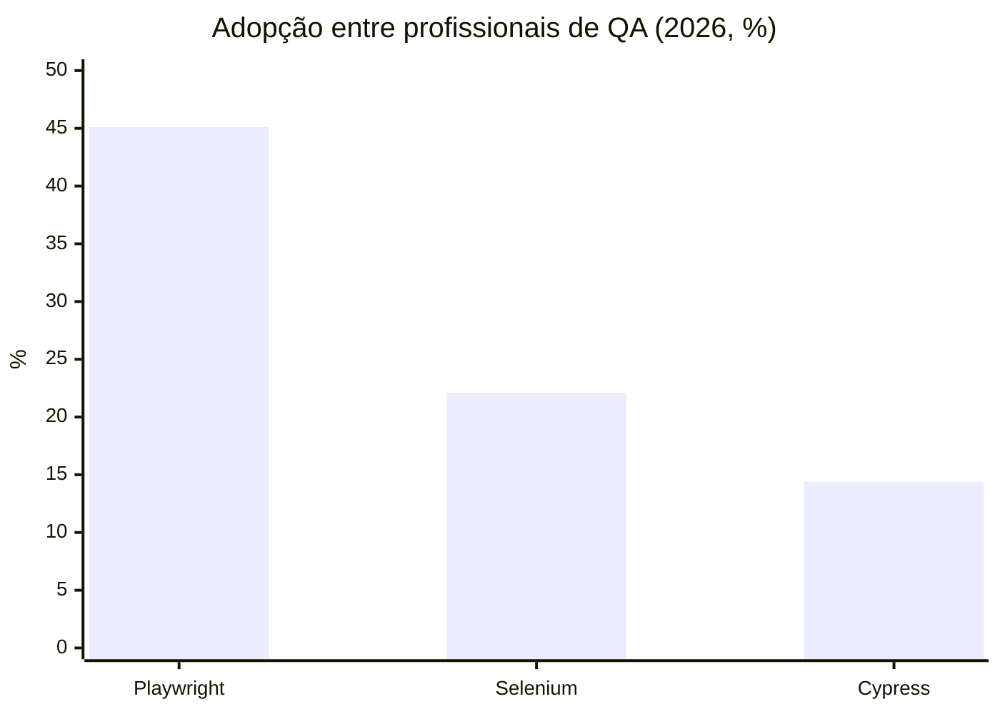

# 01. Comparação das ferramentas

Pesquisa feita em Novembro de 2026. Os números vêm de blogs e comparações de terceiros
(ver [06-fontes.md](06-fontes.md)); onde há alegações do próprio fornecedor, está dito.

## Web (E2E no browser)

| | Playwright | Cypress | Selenium |
| --- | --- | --- | --- |
| Quem mantém | Microsoft | Cypress.io | Projecto Selenium |
| Linguagens | TS/JS, Python, Java, .NET | JS/TS | Java, Python, C#, JS, etc. |
| Browsers | Chromium, Firefox, WebKit | Chromium, Firefox, WebKit (limitado) | Todos via WebDriver |
| Paralelismo | Incluído, gratuito | Mais limitado sem serviço pago | Precisa de Grid |
| Depuração | Trace Viewer, codegen, extensão VS Code | Time travel no runner | Depende da ferramenta à volta |
| Testes de API | Cliente HTTP incluído | Sim (`cy.request`) | Não (outra ferramenta) |
| IA integrada | Agentes planner/generator/healer + servidor MCP | Não de origem | Não de origem |
| Melhor para | Projectos novos, tudo-em-um | Equipas JS que valorizam o runner interactivo | Suites legadas, Java/Python empresariais |

Adopção entre profissionais de QA em 2026, segundo uma comparação de terceiros:

Outros sinais, com a ressalva de que as fontes divergem nos números exactos: o Playwright
ultrapassou o Cypress em descargas semanais no npm por volta de meados de 2024, e a
satisfação no State of JS 2025 foi de 91% contra 72% para o Cypress.

## Mobile (Flutter)

| | flutter_test | integration_test | Patrol | Maestro | Appium |
| --- | --- | --- | --- | --- | --- |
| Escreve-se em | Dart | Dart | Dart | YAML | Várias |
| Corre | Sem dispositivo (rápido) | Emulador ou dispositivo | Emulador ou dispositivo | App instalada | App instalada |
| Interage com diálogos do SO (permissões, notificações) | Não | Não | **Sim** | Sim (caixa-preta) | Sim |
| Conhece a árvore de widgets | Sim | Sim | Sim | Só via acessibilidade | Fraco com Flutter |
| Custo | Grátis | Grátis | Grátis (núcleo open source) | Grátis (núcleo) | Grátis |
| Melhor para | Unit e widget | Fluxos completos dentro da app | Fluxos que cruzam o nativo | Fluxos rápidos, legíveis por não-programadores | Equipas com infra Appium existente |

Nota: o suporte de Appium a Flutter é descrito por várias fontes como fraco, e muitas
ferramentas de teste com IA ignoram o Flutter. Ver [04-ia-nos-testes.md](04-ia-nos-testes.md).

## Backend (Laravel)

| | Pest | PHPUnit | Laravel Dusk |
| --- | --- | --- | --- |
| Relação | Camada por cima do PHPUnit | Base do ecossistema PHP | Testes de browser |
| Sintaxe | Funcional e legível | Classes | Fluente |
| Por defeito no Laravel | Sim, desde o Laravel 11 | Alternativa suportada | Pacote à parte |
| Extras | Datasets, testes de arquitectura, paralelo | Tudo o que o Pest usa por baixo | Browser real |

Para projectos já em PHPUnit não há razão técnica para migrar: o Pest corre os mesmos testes.

## Carga e desempenho

| | k6 | JMeter | Locust | Gatling |
| --- | --- | --- | --- | --- |
| Scripts | JS/TS | GUI + XML | Python | Java/Kotlin/Scala/JS |
| Ponto forte | Testes como código no CI | Maior cobertura de protocolos | Fácil para equipas Python | Alto débito na JVM |
| Escolha por defeito em 2026 | **Sim** (APIs novas) | Quando o protocolo o exige | Quando a equipa é Python | Quando a equipa é JVM |

## Plataformas de IA autónomas

| | TestSprite | Outras (Panto, Autosana, Momentic, KaneAI…) |
| --- | --- | --- |
| Foco | Web e API; integração por MCP no editor | Variado; algumas focadas em mobile |
| Corre onde | Cloud do fornecedor | Cloud do fornecedor |
| Preço | Plano grátis com créditos; pagos desde cerca de 19 $/mês (fontes divergem, confirmar no site) | Por contacto ou por agente |
| Risco | Dependência de fornecedor; testes são caixa-preta | Idem. Exemplo: a Octomind foi descontinuada em Maio de 2026 |
| Flutter nativo | **Não confirmado** (a página dedicada fala de Flutter Web) | Algumas anunciam, não verificado |
