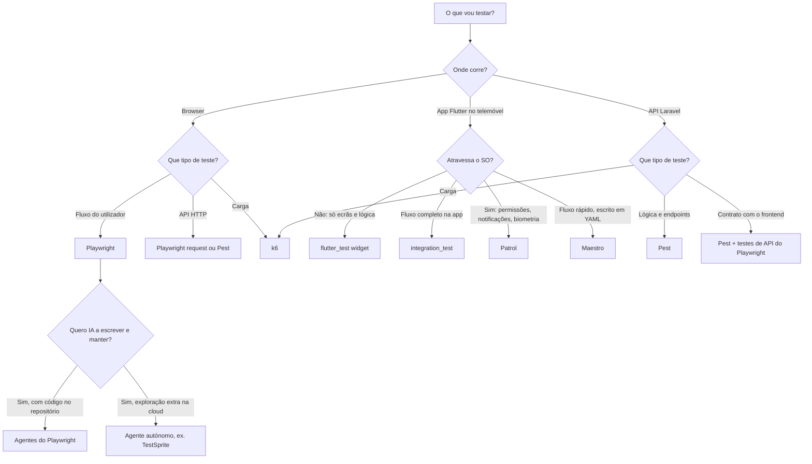
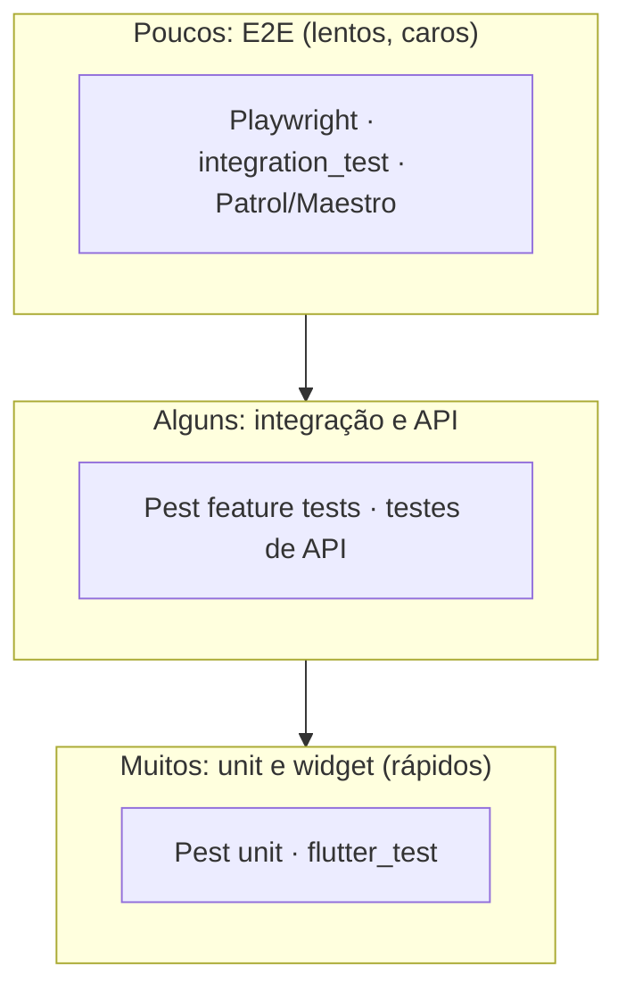

# 02. Que ferramenta usar em cada tipo de projecto

## Fluxograma de decisão

## Pirâmide recomendada

Regra prática: quanto mais em baixo, mais testes e mais rápidos. Os E2E ficam para os
fluxos que não podem falhar (login, pagamento) e correm no CI a cada alteração.

## Casos de uso

| Situação | Ferramenta | Porquê |
| --- | --- | --- |
| "O login deixou de funcionar no site" | Playwright | Fluxo no browser, com screenshots e trace quando falha |
| "A API devolve 500 com um valor negativo" | Pest (`TransferTest`) | Rápido, sem browser, corre em segundos |
| "A app Flutter pede permissão de câmara" | Patrol | Só ele controla o diálogo do sistema em Dart |
| "Quero validar o fluxo de pagamento em Android e iOS sem escrever Dart" | Maestro | YAML legível, mesmo fluxo nas duas plataformas |
| "A API aguenta 500 utilizadores?" | k6 | Limiares (p95, taxa de erro) que falham o CI |
| "Mudámos o layout e 12 testes partiram" | Healer do Playwright | Propõe correcções de localizadores, tu revês o diff |
| "Preciso de uma primeira bateria de testes num site que ninguém testou" | Planner + Generator do Playwright | Explora e gera specs que passam a ser código teu |
| "Quero um segundo par de olhos a explorar a app todas as noites" | Agente autónomo (TestSprite ou outro) | Camada extra; não bloqueia deploys |

## O que bloqueia um deploy

Só testes que vivem no repositório e correm no CI: Pest, Playwright, flutter_test,
integration_test, k6. Agentes autónomos na cloud ficam como camada de exploração, porque
um falso verde ou falso vermelho num sistema de pagamentos custa caro e o teste não é teu.
