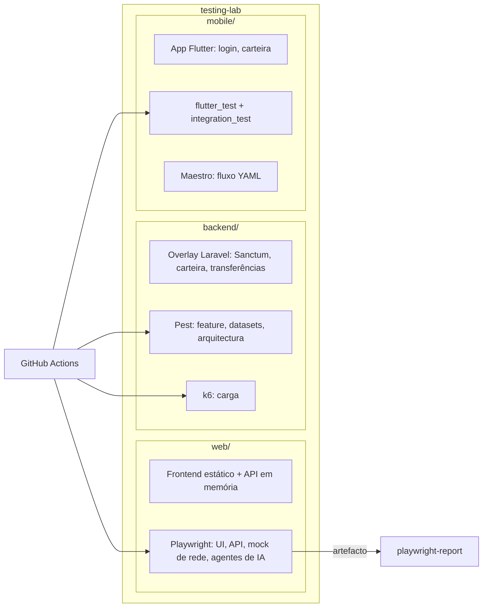

# 03. Arquitectura do laboratório

## Decisões

- **Três projectos pequenos e iguais no domínio** (login, saldo, transferência), para
  comparares como cada ferramenta testa a mesma regra de negócio.
- **O backend é um "overlay".** Em vez de commitar uma app Laravel inteira, o repositório
  guarda só os nossos ficheiros e o `backend/setup.sh` gera a app com `composer create-project`
  e aplica-os por cima. Fica sempre na versão actual do Laravel e o repositório continua pequeno.
- **A app Flutter não traz as pastas `android/` e `ios/`.** `flutter create` gera-as
  (o CI faz isso). Evita commitar ficheiros gerados.
- **Isolamento de testes.** O servidor web de exemplo tem um endpoint de reposição de estado
  só para testes, chamado por um fixture antes de cada teste.

## CI

| Workflow | O que corre | Quando |
| --- | --- | --- |
| `web.yml` | Playwright (Chromium) e relatório HTML | Alterações em `web/` |
| `backend.yml` | `setup.sh`, Pest, depois k6 contra `php artisan serve` | Alterações em `backend/` |
| `mobile.yml` | `flutter analyze`, `flutter test`; integração em emulador só manualmente | Alterações em `mobile/` |
