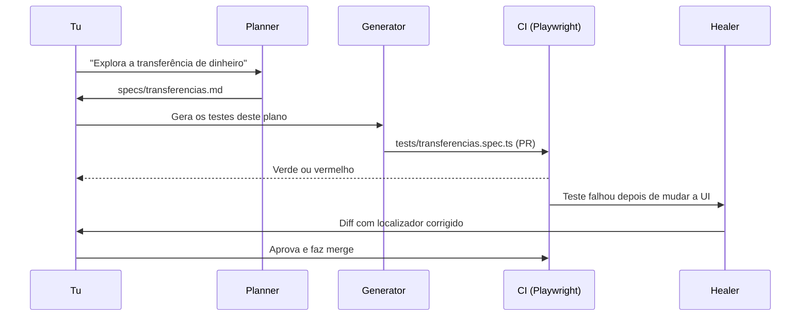

# 04. IA nos testes automatizados

Há duas famílias, com garantias diferentes.

## 1. IA que escreve código de teste (fica no teu repositório)

O Playwright traz três agentes desde a versão 1.56 (Outubro de 2025):

| Agente | O que faz | Resultado |
| --- | --- | --- |
| Planner | Explora a app e descreve cenários | Plano em Markdown em `specs/` |
| Generator | Transforma o plano em testes | Ficheiros `.spec.ts` |
| Healer | Corre testes que falham e propõe correcções | Alterações aos testes |

Ficam definidos em `web/.claude/agents/` e o servidor MCP em `web/.mcp.json`
(gerados por `npx playwright init-agents --loop=claude`). O ficheiro
`web/tests/seed.spec.ts` dá-lhes o ponto de partida (utilizador com sessão iniciada).

Vantagens: o teste é código que podes ler, versionar e correr offline; sem créditos nem
fornecedor. Regra de ouro: a IA propõe, tu aprovas o diff antes do merge.

## 2. IA que testa por ti na cloud (agentes autónomos)

Exemplo: TestSprite. Explora a app a partir de um URL ou de um PRD, gera e corre testes
na cloud do fornecedor e devolve resultados ao teu editor por MCP.

| | Agentes do Playwright | Agente autónomo (TestSprite) |
| --- | --- | --- |
| Onde vive o teste | No teu repositório | Na plataforma |
| Custo | Grátis (pagas o modelo de IA que usares) | Créditos / subscrição |
| Determinismo | Alto (código fixo) | Depende do agente |
| Cobre | Web (e API com o cliente HTTP) | Web e API |
| Flutter nativo | Não | Não confirmado |
| Risco | Rever diffs gerados | Dependência de fornecedor |

**Recomendação para este laboratório:** IA da família 1 como base; família 2 como extra de
exploração, sem bloquear deploys. Um exemplo de por que a dependência importa: a Octomind,
uma plataforma de testes com IA, foi descontinuada em Maio de 2026.

## Experimenta

1. `cd web && npm ci`
2. Abre o projecto no teu editor com suporte a agentes (Claude Code, VS Code com Copilot).
3. Pede ao planner: "explora a página da carteira depois do login e propõe cenários".
4. Pede ao generator para gerar os testes de um cenário e corre `npx playwright test`.
